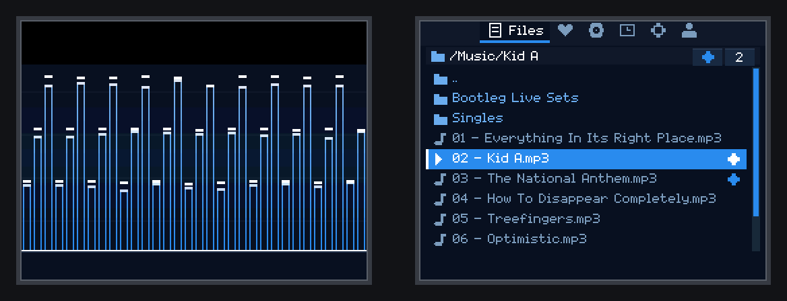
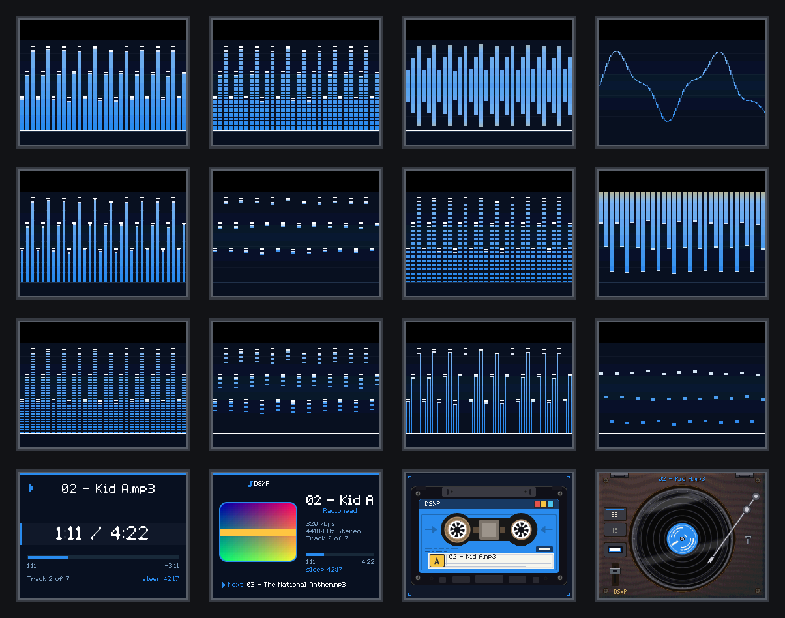

# DSXP — an MP3 player for Nintendo DS

Homebrew for real DS/DS Lite/DSi hardware (or an emulator), built on
devkitARM + libnds. Top screen is a music-reactive visualizer; bottom
screen is a file browser and transport. Every pixel of it is drawn in
code — there is no sampled artwork anywhere in the program, so there is
nothing in it that cannot be shipped.




## Licence

**GPL-2.0-or-later.** DSXP links
[libmad](https://www.underbit.com/products/mad/), which is GPL-2, so the
combined work is covered by the same licence — see `LICENSE` for the full
text.

In practice that means: if you hand someone the built `dsxp.nds`, they are
entitled to the corresponding source. Publishing the repository alongside
the binary satisfies that completely; posting the ROM on its own does not.

Copyright (C) 2026 Farzin Abdi.

## Building

```
export DEVKITPRO=/opt/devkitpro
export DEVKITARM=/opt/devkitpro/devkitARM

./tools/build_libmad.sh    # once — see "libmad" below
make
```

Produces `dsxp.nds`. Copy it to your flashcart's SD card along with some
audio files anywhere on the card.

### Formats

| Extension | Codec | Decoder | Length and seeking |
|---|---|---|---|
| `.mp3` | MPEG-1/2 Layer III | libmad, fixed point | exact with a Xing/VBRI header or CBR, else estimated |

That is the whole list: the browser shows `.mp3` and nothing else, and a
file of any other kind is not listed at all. Four more formats — WAV,
FLAC, Vorbis and AAC — were here once and were taken out again; the
decoder still keeps the shape that had them, which is why the resampler
and the length-and-seek machinery are written as if a second format
might arrive.

Output is resampled to 32768 Hz, which is maxmod's documented ceiling on
this hardware, by a polyphase filter.

The format is decided by the file's contents, not its extension. The
table above is what the browser offers; a file whose name lies about what
is inside it still plays as what it is.


`make test` runs the host-side checks (no DS required): the decoder is
driven against synthetic MPEG files, and every UI screen is rendered to a
BMP in `tools/hosttest/build/` so the layout can be reviewed without
hardware.

## Controls

| Input | Action |
|---|---|
| D-pad Up/Down | Move selection (Files) / volume (Now Playing) / ±10 min (Sleep) |
| D-pad Left/Right | Page up/down the file list / ±1 min (Sleep) |
| A | Play the selected file or enter the folder (Files) / play-pause (Now Playing) / start-cancel the timer (Sleep) |
| B | Go up a folder (Files) / play-pause elsewhere |
| X / Y | Next / previous track |
| **L / R** | Seek backward / forward within the track (hold to keep seeking) |
| Y (on the Sleep tab) | Toggle "turn the DS off when it ends" |
| A / Y (on the Setup tab) | Switch lid behaviour / audio quality |
| START | Cycle through Files → Playing → Sleep → Setup |
| SELECT | Blank the screens (any input restores) |
| Touch | Transport buttons, tabs, list rows; drag the volume and sleep sliders; tap the progress bar to seek |
| Screen-off button (titlebar) | Blank both screens, keep playing; any input restores |
| **Close the lid** | Screens off, music keeps playing (DS/DS Lite) |

Tapping a file list row selects it; tapping the row that is *already*
selected opens it, so a stray touch does not start playing something.

### Saved settings

Volume, visualizer mode, lid behaviour, idle blanking, sleep length,
"turn the DS off" and audio quality are written to
**`/dsxp_info/dsxp.cfg`** on the card — plain `key=value` text, safe to
edit or delete. Everything this program writes lives under
`/dsxp_info/`: the settings file, and `playlists/` beside it. Nothing is
left at the root. Values outside
their valid range are discarded in favour of the default rather than
clamped, so a corrupt file gives a sane player rather than a strange one.

Writes are **debounced by three seconds** and only happen once a value has
settled. Dragging the volume slider changes it on every frame, and
committing each of those to the card would pound the filesystem and hitch
playback for nothing.

### Setup tab

- **When the lid closes** — *Keep playing* (default) or *Sleep*. This is
  implemented by handing the hinge back to calico via
  `pmSetSleepAllowed()`, so choosing *Sleep* gets a genuine system sleep
  with the backlight properly off — at the cost of stopping the music.
  That is the honest trade, and it is why it is a setting rather than a
  guess: the ARM9 cannot turn the backlight off on its own — see
  [`docs/notes.md`](docs/notes.md).
- **Audio quality** — *Standard* (12-tap resampling filter) or *High*
  (24-tap, default). Switchable while playing, so the two can be compared
  by ear on real hardware, which is the only place that judgement can
  honestly be made. The setting is about the *resampler*, not the output
  device: there is no separate "headphone mode" because nothing in the
  decode path should differ by what is plugged in. Headphones simply make
  the difference easier to hear.
- **Extra volume** — a slider, off to +20 dB. The resampler holds back
  2.2 dB so transients cannot clip, so **+2 dB hands exactly that back**
  and is the natural choice for quiet recordings; everything above pushes
  past unity and will clip loud material, which is a fair trade to offer
  rather than to make on the user's behalf.
- **Noise filter** and **Enhance** — two optional output effects, both
  off by default. A downward expander for tape hiss and encoder
  noise, and a high-frequency lift. Measurements for both are in
  [`docs/notes.md`](docs/notes.md).


Up/Down move between rows, Left/Right (or A) change the highlighted one,
and a touch picks a value directly.

### Top screens

Sixteen to choose from on the Setup tab — twelve meters and four cards.



Left to right, top to bottom: **Bars, Blocks, Mirror, Wave** ·
**Wide, Dots, Comb, Hang** · **Steps, Trail, Edge, Drop** ·
**Now playing, Cover, Cassette, Gramophone**.

The meters all read the same spectrum and differ only in how a column is
drawn, so they cost about the same. The cards replace the meter with
something still: the track and a large clock, the embedded cover art if
the file has any, or one of two pieces of machinery that move with the
music. Edge is the default.

### Diagnostics

Hidden by default. On the **Setup** tab press **Left, Right, Left,
Right** — a *Diagnostics* row appears at the bottom; A opens it. The
sequence is only watched for, so those keys keep changing whatever row
the cursor is on while you type it. Do it on a two-value row, such as
the headphone switch, and the setting lands back where it started.

It hides again on the next launch; nothing about the unlock is written
to the card.

The page is for finding out *why* something sounds or looks wrong, and
splits in two. Readouts: how full the audio buffer is, how many glitches
there have been, what share of the processor the decoder is using
(broken down into bit-reading, the synthesis filter and resampling), and
what the screen costs per frame. Controls: the resampler mode, a rate
cut, the noise filter and enhance levels, CRC checking, list scroll
speed, cover detail and fetch pace, counter reset, reset-to-defaults,
and a hardware register readout.

## Notes

[`docs/notes.md`](docs/notes.md) covers why it is built this way: the
decode path and its budget, the headphone pin on the DSi, how the bottom
screen avoids repainting, and the measurements behind the choices.

## Known limitations

- **`.mp3` only.** Other formats are not listed in the browser.
- **256 entries per folder.** Longer folders are truncated; the path bar
  says so, with the count that did fit.
- **Transliteration, not script.** Persian, Arabic and accented Latin
  names are romanised to the font's alphabet — "Dariush", not the name as
  written. Rendering the script itself needs an Arabic font, contextual
  shaping and right-to-left layout.
- **Seek accuracy depends on the file.** Exact on CBR and on VBR with a
  Xing/VBRI table; estimated otherwise, and marked with a leading `~`.
